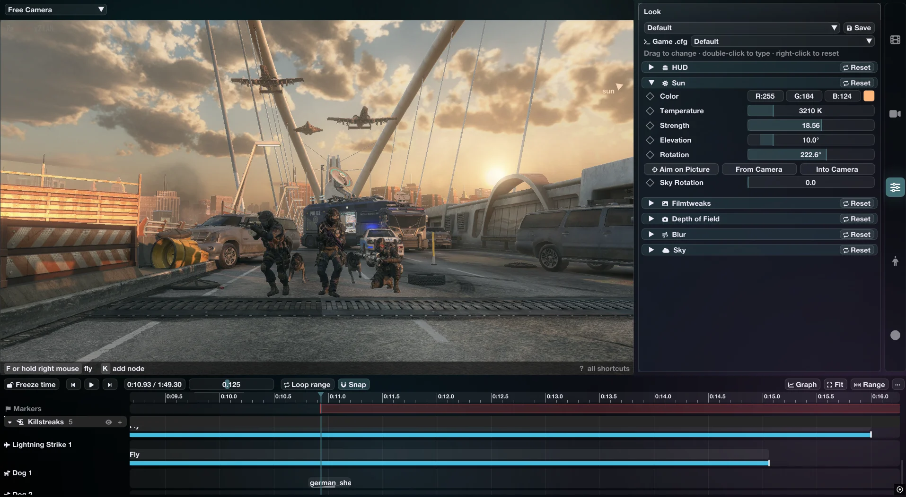
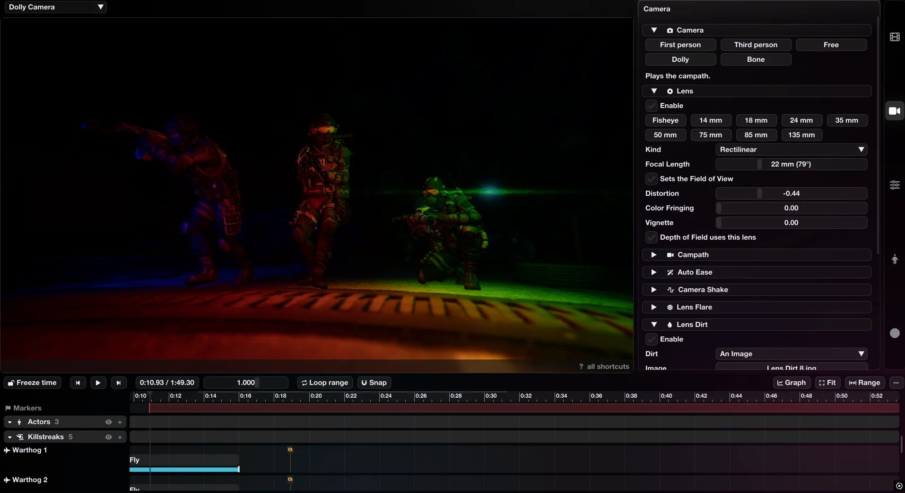
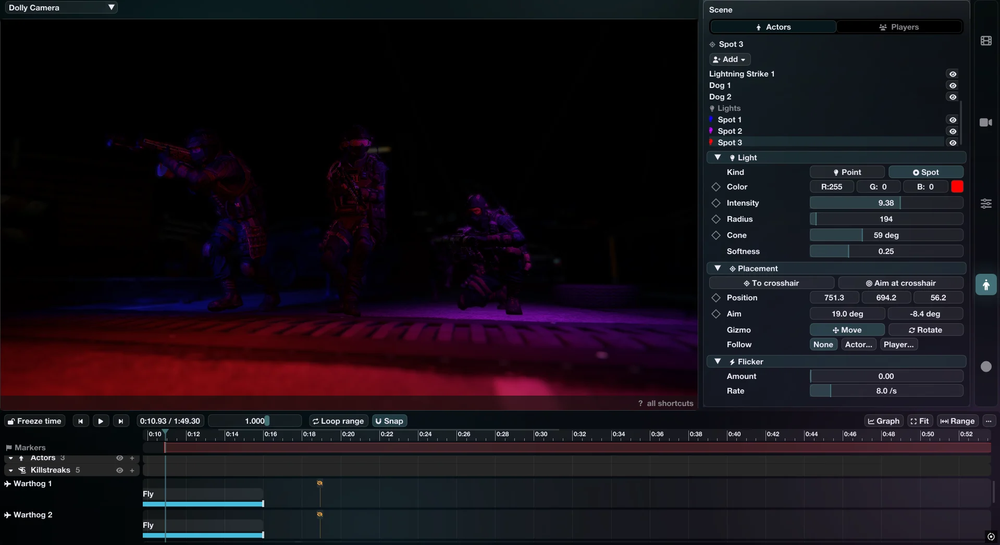
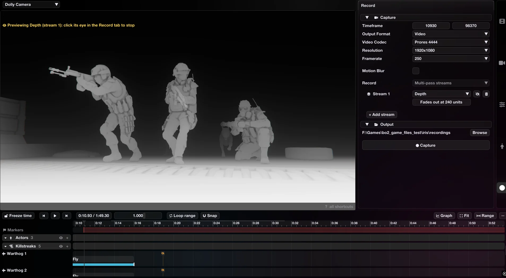
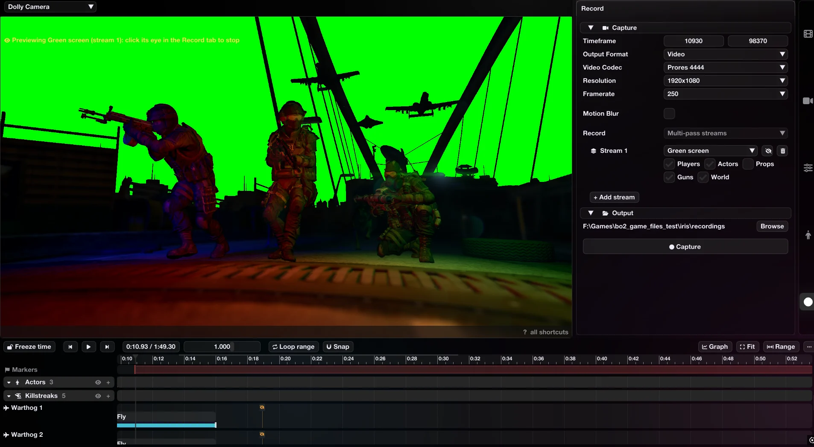
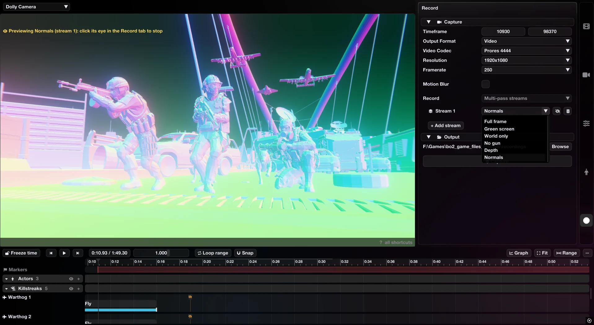

<h1 align="center">T6Iris</h1>

<p align="center">A movie-making editor for <b>Call of Duty: Black Ops II</b> films (theater demos), on the Redacted client.</p>

<p align="center">
  <a href="https://github.com/SonderEnterprises/T6Iris/releases"></a>
</p>

T6Iris loads into Black Ops II as a Redacted plugin and puts an editor around film playback: a timeline you can rewind,
camera paths with keyframes, characters and killstreaks you place and animate inside the film, visual controls, and
recording straight from the game, including green screen and other passes for compositing.

It's built on [Iris Studio](https://github.com/yerbisonline/IrisStudio), a fork of
[IWXMVM](https://github.com/reallyluckyy/IWXMVM). The original Iris Studio readme is in
[docs/IrisStudio-README.md](docs/IrisStudio-README.md).

> [!WARNING]
> **Offline only.** Use it for watching and recording films. Never join online servers with the plugin loaded.

> [!NOTE]
> **Test releases.** Most of the code was written by an AI (Claude), directed and tested by its makers. Expect rough
> edges, and report problems in [Issues](https://github.com/SonderEnterprises/T6Iris/issues) with your `IWXMVM.log`.

## Features

- **Cameras:** first person, third person, free, dolly (campaths with keyframes) and a bone camera. Lenses, depth of
  field with bokeh, camera shake, lens flares and lens dirt.
- **Look:** colour grading, sky and fog, and running your own game `.cfg` files (with a way back to the defaults).
- **Actors:** any multiplayer character, with the multiplayer and campaign animations, paths to walk, guns with their
  attachments and camos, shots with muzzle flashes and hits, and an actor that **shoots at** another actor.
- **Killstreaks:** RC-XD, A.G.R., Sentry Gun, Guardian, Care Package, dogs and the air killstreaks, with their moving
  parts, lights, exhaust, blasts and guns that fire. Props and effects of the map too.
- **Recording:** ProRes or video straight from the game, and multi-pass streams: Full frame, Green screen, World only,
  No gun, Gun only, Depth and Normals. The **Green screen** keeps whatever you tick: players, actors, props, guns or the
  world.
- **The editor:** tabs as icons on the right, a glass look with a gradient you choose, animated panels and sections,
  and the Alte Haas Grotesk font.

## Screenshots



**Actors, killstreaks and the sun.** Soldiers and dogs placed as actors with their animations, and a Lightning Strike's Warthogs flying over, all on the film's timeline. The Look tab's **Sun** sets the light's colour, temperature, strength, elevation and rotation, here a low warm sunset; it can be aimed on the picture, taken from the camera or put behind it.



**Lens, flares and dirt.** The dolly camera through a 22 mm lens with barrel distortion, a **lens flare** streaking from the green light and **lens dirt** from an image catching the glow. The lens also offers fisheye, focal lengths from 14 to 135 mm, colour fringing and a vignette, and depth of field can follow it.



**Lights.** Point and spot lights you place and key over time: colour, intensity, radius, the cone and its softness, aimed at the crosshair or moved with a gizmo, following an actor or a player, and flickering if you like. Here three spot lights (blue, purple and red) light the actors in a map darkened with a game `.cfg`.



**Depth pass.** A black-and-white depth stream for depth of field and fog in your editor, with the distance it fades out at set on the stream.



**Green screen.** Everything you don't keep turns green for keying. Tick what stays: **Players**, **Actors**, **Props**, **Guns** and the **World** (here kept, so only the sky is green).



**Normals pass and the streams.** Surfaces coloured by the way they face, for relighting in compositing. Multi-pass recording captures any of these streams at once, frame for frame: **Full frame**, **Green screen**, **World only**, **No gun**, **Depth** and **Normals**.

## Installation

You need **Call of Duty: Black Ops II** on PC with the **Redacted** client.

1. Download `T6iris-<version>.zip` from [Releases](https://github.com/SonderEnterprises/T6Iris/releases).
2. Close the game.
3. Copy the `Plugins` folder from the zip into your Black Ops II folder (the one with `t6mp.exe` and Redacted), and let
   it merge with the one that's there.
4. Copy `T6iris-campaign-animations.bin` into the Black Ops II folder itself, next to `t6mp.exe`.
5. Start the game with Redacted. Press **F1** to show or hide the editor, and pick a film on the Demo tab.

Recordings go to `<Black Ops II>\iris\recordings` unless you choose another folder in the Record tab. Settings, scenes
and keyframes are kept in `<Black Ops II>\iris`. `INSTALL.txt` in the zip has the details.

## Default keys

Every key can be changed in Controls; **?** lists them all in the game.

| Key | Action |
| --- | --- |
| **F1** | Show or hide the editor |
| **Space** | Play or pause |
| **B / N** | Start / end of the recording range |
| **F**, or hold right mouse | Fly the free camera |
| **K** | Add a campath node |

## Building it yourself

Requirements: Visual Studio 2022 (or its Build Tools) with the C++ desktop workload, and the
[DirectX SDK (June 2010)](https://www.microsoft.com/en-us/download/details.aspx?id=6812) with `DXSDK_DIR` pointing to it.

```bash
git clone --recursive https://github.com/SonderEnterprises/T6Iris.git
```

```bash
MSBuild IWXMVM.sln /t:t6 /p:Configuration=Release /p:Platform=x86
```

The build makes `t6\bin\Win32\Release\T6iris.Red32n`, the Redacted plugin.

## Credits

- **[IWXMVM](https://github.com/reallyluckyy/IWXMVM)**, the editing mod T6Iris is built on, by
  [reallyluckyy](https://github.com/reallyluckyy) and its contributors: [Caball009](https://github.com/Caball009),
  [kruumy](https://github.com/kruumy), [lxkast](https://github.com/lxkast), [mallgrab](https://github.com/mallgrab),
  [imgemmy](https://github.com/imgemmy) and [mrks2](https://github.com/mrks2).
- **[Iris Studio](https://github.com/yerbisonline/IrisStudio)**, the fork of IWXMVM that T6Iris continues.
- **[Plutonium](https://plutonium.pw)**, whose game files Black Ops II runs with.

## License

GPL-3.0, as Iris Studio and IWXMVM are: see [LICENSE](LICENSE). The libraries and fonts it uses, with their licences,
are listed in [t6/release/THIRD-PARTY.txt](t6/release/THIRD-PARTY.txt).
