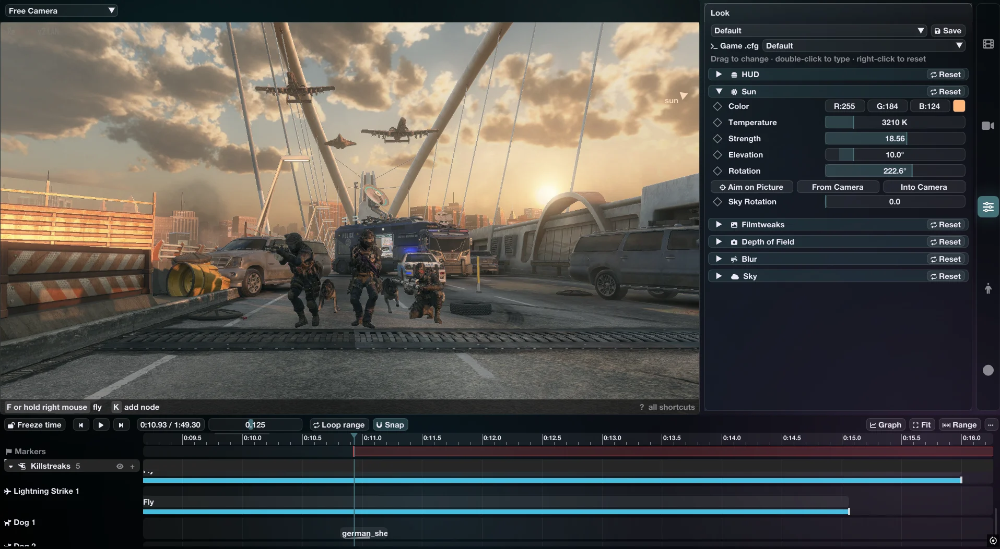
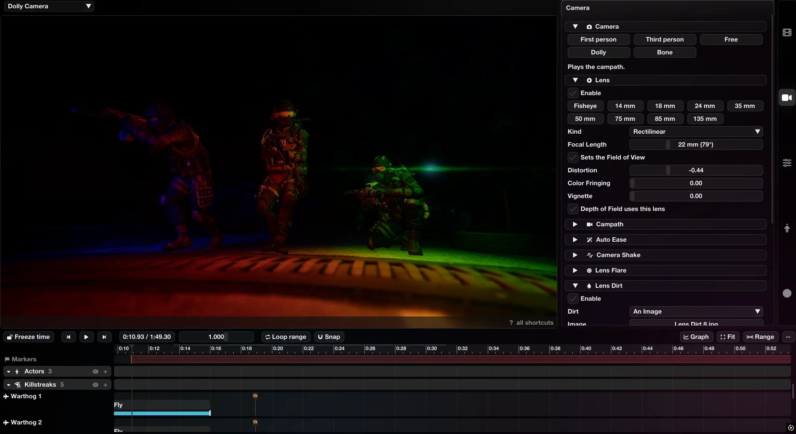
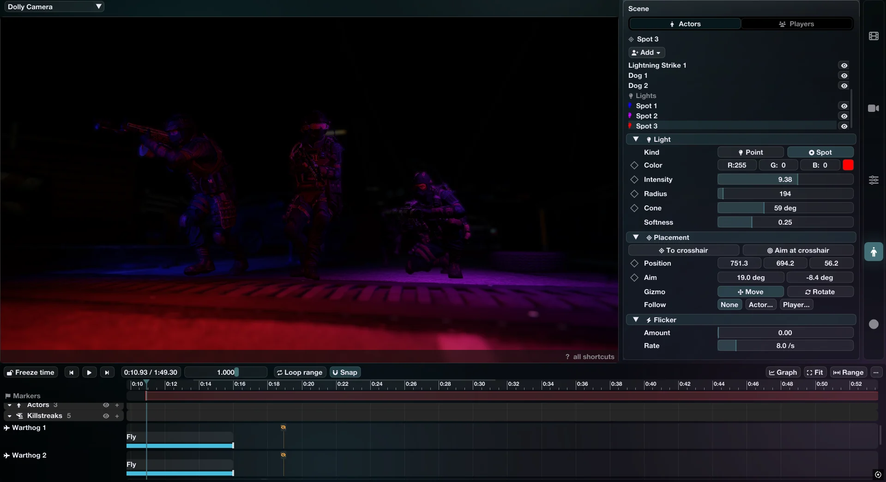
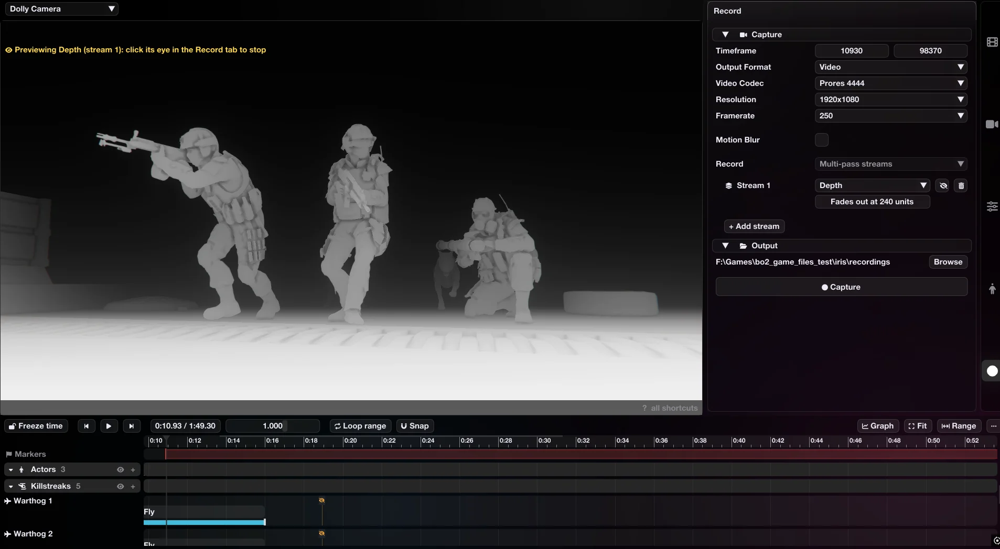
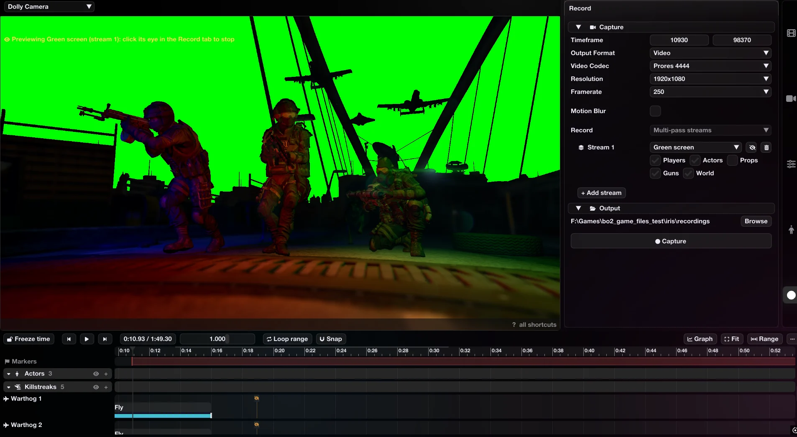
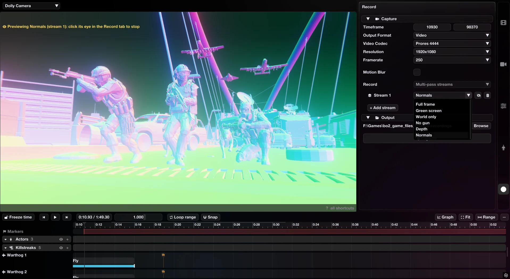

# T6Iris 1.3.4

A movie-making editor for **Black Ops II** films (theater demos), on the Redacted client.

> **Test release.** Things may break: if something goes wrong, see *Reporting a problem* below.

## Download

Get **T6iris-1.3.4.zip** from the assets below, then follow `INSTALL.txt` inside it:

1. Close the game.
2. Copy the `Plugins` folder from the zip into your Black Ops II folder (the one with the Redacted client) and let it merge.
3. Copy `T6iris-campaign-animations.bin` next to `t6mp.exe` for the campaign's animations.
4. Start the game with Redacted, and press **F1** to show or hide the editor.

## What's in it

- **Cameras:** free, dolly (campaths with keyframes) and bone cameras; lenses, depth of field with bokeh, shake, lens flares and lens dirt.
- **Look:** colour grading, sky and fog, and your own game `.cfg` files.
- **Scene:** actors (any multiplayer character) with animations, guns, shots and hits; killstreaks with moving parts, lights and blasts; props and effects. An actor can **shoot at** another.
- **Record:** ProRes or video straight from the game, and multi-pass streams: Full frame, **Green screen**, World only, No gun, Gun only, Depth and Normals.
- **The editor:** tabs as icons on the right, a glass look with a gradient you can colour, and the Alte Haas Grotesk font.

## Screenshots

**Actors, killstreaks and the sun.** Soldiers and dogs placed as actors with their animations, and a Lightning Strike's Warthogs flying over, all on the film's timeline. The Look tab's **Sun** sets the light's colour, temperature, strength, elevation and rotation, here a low warm sunset; it can be aimed on the picture, taken from the camera or put behind it.

**Lens, flares and dirt.** The dolly camera through a 22 mm lens with barrel distortion, a **lens flare** streaking from the green light and **lens dirt** from an image catching the glow. The lens also offers fisheye, focal lengths from 14 to 135 mm, colour fringing and a vignette, and depth of field can follow it.

**Lights.** Point and spot lights you place and key over time: colour, intensity, radius, the cone and its softness, aimed at the crosshair or moved with a gizmo, following an actor or a player, and flickering if you like. Here three spot lights (blue, purple and red) light the actors in a map darkened with a game `.cfg`.

**Depth pass.** A black-and-white depth stream for depth of field and fog in your editor, with the distance it fades out at set on the stream.

**Green screen.** Everything you don't keep turns green for keying. Tick what stays: **Players**, **Actors**, **Props**, **Guns** and the **World** (here kept, so only the sky is green).

**Normals pass and the streams.** Surfaces coloured by the way they face, for relighting in compositing. Multi-pass recording captures any of these streams at once, frame for frame: **Full frame**, **Green screen**, **World only**, **No gun**, **Depth** and **Normals**.

## New in 1.3.4

- **Recording works when your Black Ops II folder has spaces in its name** (for example `E:\games\bo2 t6`). Before, ffmpeg couldn't start there, so a capture finished but no video was saved. If you're on 1.3.3 and your recordings never appear, update to this.

## New in 1.3.3

- Two or more lights now all show: the game lights one spot light at a time, so any spot after the first is drawn as a point light along its beam.
- The editor's top bar shows just the version.

## New in 1.3.2

- Green screen works in Black Ops II: the map is taken away, so only what you keep stays over the green.
- Green screen ticks for each part: Players, Actors, Props, Guns (what they hold, and the first person gun) and World.

## New in 1.3.1

- A new look on a first start: black glass, white text, round corners and the Alte Haas Grotesk font.
- Getting started is a short tour of each tab.
- The dolly camera starts where your free camera was.

## New in 1.3

- Killstreaks as actors, with moving parts, effects and guns that fire.
- Shoots at: an actor aims at another; its shots flash toward it and hit it.
- The new editor look, smoother animations and more compact controls.
- The view keeps the game's shape in a film, so the picture fills it.
- Simpler multi-pass recording, and running a game `.cfg`.

## Reporting a problem

Send `IWXMVM.log` from your Black Ops II folder (and `IWXMVM.1.log` if there is one), with what you did just before it went wrong. If the game froze or crashed, send it before starting the game again.

## Credits

- **[IWXMVM](https://github.com/reallyluckyy/IWXMVM)**, the editing mod T6Iris is built on, by [reallyluckyy](https://github.com/reallyluckyy) and its contributors: [Caball009](https://github.com/Caball009), [kruumy](https://github.com/kruumy), [lxkast](https://github.com/lxkast), [mallgrab](https://github.com/mallgrab), [imgemmy](https://github.com/imgemmy) and [mrks2](https://github.com/mrks2).
- **[Iris Studio](https://github.com/yerbisonline/IrisStudio)**, the fork of IWXMVM that T6Iris continues.
- **[Plutonium](https://plutonium.pw)**, whose game files Black Ops II runs with.

## Source and licences

T6Iris is under the GPL-3.0, as IWXMVM and Iris Studio are. Its source code is this repository; the libraries and fonts it uses and their licences are listed in `THIRD-PARTY.txt` in the zip.
